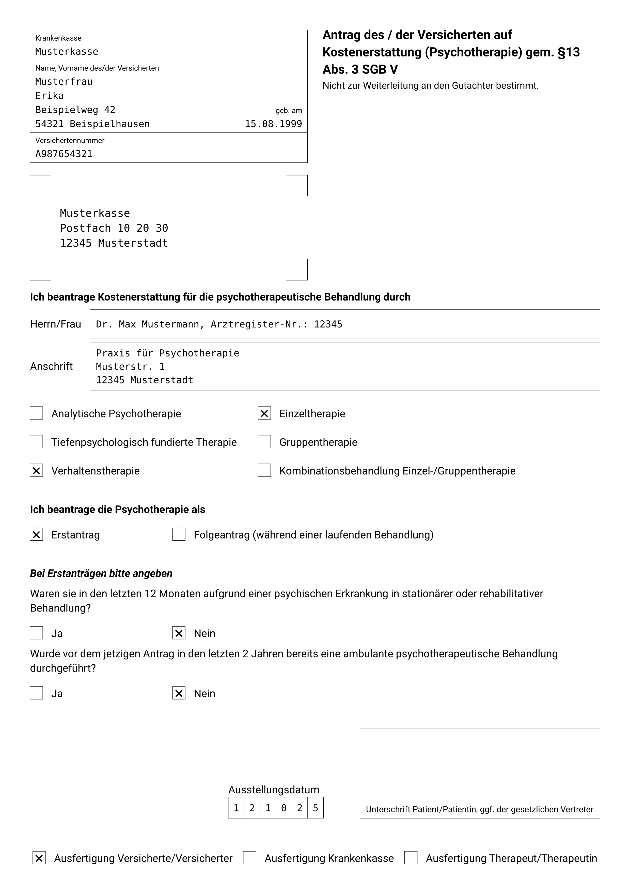
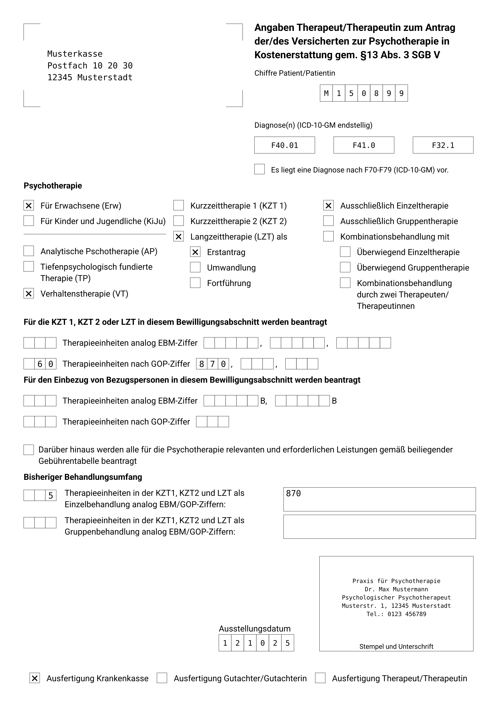

# typst Forms for German Psychotherapy (PTV)

[](LICENSE)
[](https://github.com/benediktclaus/ptv-forms/releases)
[](https://github.com/benediktclaus/ptv-forms/commits/main)

A `typst` package to generate all necessary forms for a psychotherapy application via the German cost reimbursement procedure ("Kostenerstattung").

## Preview

The package generates multiple documents, including the patient's application (PTV 1), the therapist's report forms (PTV 2), and the envelope for the reviewer (PTV 8). Here is a sample:

| PTV 1 | PTV 2 |
| :---: | :---: |
|  |  |

## Features

* **Complete Form Set:** Generates all required documents for the application process:
    * Cover Letter
    * Patient's Application (`PTV 1`)
    * Therapist's Information (`PTV 2`)
    * Declaration of Assignment (`Abtretungserklärung`)
    * Envelope for the Reviewer (`PTV 8`)
* **Automated & Reusable Data:** Uses a central `config.typ` file for your therapist data, which is reused across all forms.
* **Easy Configuration:** A single function call generates the entire set of documents with all patient data correctly placed.
* **Checkbox Control:** Easily check the required boxes on the forms via an array of simple strings.

## Installation

This template requires a few dependencies to be installed manually to work as intended.

### Step 1: Install Required Fonts

This template is designed to use specific fonts for optimal appearance. Please download and install them on your system from their official sources:

* **[Roboto](https://fonts.google.com/specimen/Roboto)**
* **[DejaVu Sans Mono](https://www.fontsquirrel.com/fonts/dejavu-sans-mono)** (for checkboxes and data boxes)

### Step 2: Install `letter` Package

This template depends on the `letter` package to generate the cover letter. Please install it first by following its [local installation guide](https://github.com/benediktclaus/letter#installation).

### Step 3: Install This Template

1.  **Download the Latest Release:** Go to the [Releases page](https://github.com/benediktclaus/ptv-forms/releases) and download the source code ZIP file of the latest version.
2.  **Find Your Local typst Package Directory:** You need to find the standard package directory for your operating system.
    * **Windows:** `%APPDATA%\typst\packages\` (e.g., `C:\Users\<YourName>\AppData\Roaming\typst\packages`)
    * **macOS:** `~/Library/Application Support/typst/packages/`
    * **Linux:** `~/.local/share/typst/packages/`
3.  **Move the Package Files:** Extract the downloaded ZIP file. Create the following folder structure inside your `packages` directory and move the extracted contents into it.
    `.../packages/local/ptv-forms/0.2.0/`
    Inside this `0.2.0` folder, you should place the `typst.toml` and `lib.typ` files.

### Step 4: Create a `config.typ` File

This template requires a `config.typ` file in your project's root directory to store your personal therapist information. Create this file and add the following content, adapted with your own data:

```typst
#let therapeut = [Dr. Jane Doe]
#let anrede = [Frau]
#let arztregister-nr = [12345]
#let berufsbezeichnung = [Psychologische Psychotherapeutin (VT)]
#let praxisadresse = [
  Praxis für Psychotherapie\
  Musterstr. 1\
  12345 Musterstadt
]
#let stempel = [
  Praxis für Psychotherapie\
  Dr. Jane Doe\
  Psychologische Psychotherapeutin\
  Musterstr. 1, 12345 Musterstadt\
  Tel.: 0123 456789
]
```

## Usage

Create a `main.typ` file in your project folder. Import this package and your `config.typ`. The `#show: ptv.with(...)` rule will generate all documents.

```typst
#import "@local/ptv-forms:0.2.0": *
#import "config.typ": *

#show: ptv.with(
  // Therapist data is loaded from config.typ
  therapeut: therapeut,
  anrede: anrede,
  arztregister-nr: arztregister-nr,
  berufsbezeichnung: berufsbezeichnung,
  praxisadresse: praxisadresse,
  stempel: stempel,

  // Patient and insurance data
  krankenkasse: [Musterkrankenkasse],
  krankenkasse-adresse: [Krankenkassenstr. 1, 12345 Krankenkassenstadt],
  vorname: [Horst],
  nachname: [Grabowski],
  adresse: [Patientenstr. 27, 45678 Patientenstadt],
  geburtsdatum: [01.04.1956],
  vnummer: [K123456789],
  datum: [01.04.2025],
  diagnosen: ([F32.0], [], []),
  checks: ("vt", "einzel", "erstantrag", "erw", "lzt"),
  
  // Billing details
  einheiten-gop: [60],
  ziffern-gop: ([870], [], []),
)

// The body of the letter is placed here
Sehr geehrte Damen und Herren,

hiermit beantrage ich die außervertragliche Psychotherapie für Ihren oben genannten Versicherten.
```

## Parameters

The main `ptv()` function accepts the following parameters. Note that therapist-specific data is usually loaded from `config.typ`.

| Parameter | Type | Description |
| :--- |:--- | :--- |
| `therapeut` | content | Therapist's name. |
| `anrede` | content | Therapist's title, e.g., `[Herr]` or `[Frau]`. |
| `arztregister-nr` | content | Therapist's official registration number. |
| `berufsbezeichnung` | content | Therapist's professional title. |
| `praxisadresse` | content | The full address of the practice. |
| `stempel` | content | The content for the therapist's stamp box. |
| `krankenkasse` | content | Patient's health insurance company. |
| `krankenkasse-adresse` | content | Address of the insurance company. |
| `vorname` | content | Patient's first name. |
| `nachname` | content | Patient's last name. |
| `geburtsdatum` | content | Patient's date of birth. |
| `adresse` | content | Patient's address. |
| `vnummer` | content | Patient's insurance number. |
| `diagnosen` | array | An array of 3 content elements for diagnoses, e.g., `([F32.0], [], [])`. |
| `einheiten-ebm`/`gop` | content | Number of therapy units (EBM or GOP). |
| `einheiten-ebm`/`gop-bezugsperson` | content | Number of units including relatives. |
| `ziffern-ebm`/`gop` | array | An array of 3 content elements for billing codes. |
| `ziffern-ebm`/`gop-bezugsperson` | array | An array of 2 content elements for billing codes with relatives. |
| `bisher-einzel`/`gruppe` | content | Number of previously conducted sessions (single/group). |
| `bisher-einzel`/`gruppe-ziffern` | content | Billing codes for previously conducted sessions. |
| `checks` | array | An array of strings that identifies which checkboxes to tick. See below. |
| `datum` | content | The date of the application. |

*Note: `EBM` (Einheitlicher Bewertungsmaßstab) and `GOP` (Gebührenordnung für Psychotherapeuten) are German medical billing standards.*

## Checkboxes

The `checks` parameter controls which boxes are ticked on the forms. Provide an array of strings, e.g., `("erw", "lzt", "vt")`.

| String | Checkbox |
| :--- | :--- |
| `"ap"` | Analytische Psychotherapie |
| `"tp"` | Tiefenpsychologisch fundierte Therapie |
| `"vt"` | Verhaltenstherapie |
| `"kombination"` | Kombinationsbehandlung Einzel-/Gruppentherapie |
| `"station-ja"` | Stationäre oder rehabilitative Behandlung in den letzten 12 Monaten |
| `"station-nein"` | Keine stationäre oder rehabilitative Behandlung in den letzten 12 Monaten |
| `"ambulant-ja"` | Ambulante Psychotherapie in den letzten 2 Jahren |
| `"ambulant-nein"` | Keine ambulante Psychotherapie in den letzten 2 Jahren |
| `"f70"` | Es liegt eine Diagnose nach F70-F79 (ICD-10-GM) vor |
| `"erw"` | Für Erwachsene (Erw) |
| `"kiju"` | Für Kinder und Jugendliche (KiJu) |
| `"kzt1"` | Kurzzeittherapie 1 (KZT 1) |
| `"kzt2"` | Kurzzeittherapie 2 (KZT 2) |
| `"lzt"` | Langzeittherapie (LZT) als |
| `"erstantrag"` | Erstantrag |
| `"umwandlung"` | Umwandlung |
| `"fortführung"` | Fortführung |
| `"einzel"` | Ausschließlich Einzeltherapie |
| `"gruppe"` | Ausschließlich Gruppentherapie |
| `"kombi-einzel"` | Überwiegend Einzeltherapie |
| `"kombi-gruppe"` | Überwiegend Gruppentherapie |
| `"kombi-zwei"` | Kombinationsbehandlung durch zwei Therapeuten/Therapeutinnen |

## Contributing & Feedback

This package is designed for practical use. If you have suggestions for improvements or encounter any issues, please feel free to [open an issue](https://github.com/benediktclaus/ptv-forms/issues).

## License

This project is licensed under the **MIT License**. See the `LICENSE` file for details.